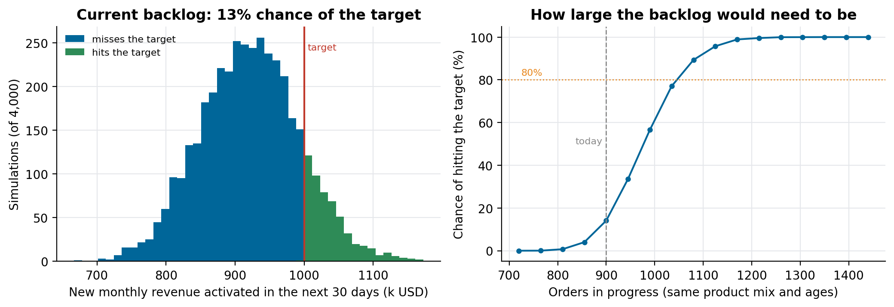
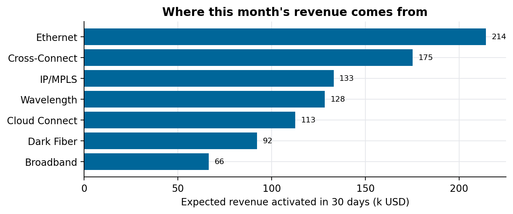

# Backlog revenue forecast

Forecast how much revenue a backlog of service orders will activate this month, the chance of hitting a target, and how large the backlog would need to be.

Companion code for the article **[Will we hit the target this month? Forecasting with AI agents](https://lucas.rangeltech.net/articles/h8-forecasting-with-ai-agents/)**.

## The problem

A telecom operator earns the monthly revenue of a new service only once it is activated, often months after the sale. Every month the question is whether the orders in progress add up to the target.

This repository answers it on synthetic data with the real shape: 6,000 completed orders (product, country, revenue, days to activation) and 900 orders in progress (product, country, revenue, days open).

> All data in this repository is synthetic, generated by the scripts with a fixed seed, with the shape of a real client problem. No client data, names or code are included.

## What the code does

- **Chance of activating in 30 days, per order:** among past orders of the same product (and country, if there are at least 30) that were still open at the same age, the share that activated within the next 30 days. No model training; every probability is a count.
- **Revenue this month:** a Monte Carlo over those chances (4,000 draws) gives the distribution and the chance of hitting the target.
- **Backlog needed:** the same calculation with the backlog scaled up, keeping its mix of products and ages.
- **Priority score:** 30% country and 20% product weight of evidence for high-revenue orders, 50% urgency.

## Results

| | Value |
|---|---:|
| Expected new monthly revenue activated in 30 days | 921k |
| 10th to 90th percentile | 829k to 1,013k |
| Chance of the 1,000k target | 13% |
| Orders in progress for an 80% to 90% chance | about 1,035 to 1,080 (15% to 20% more) |





## Run it

Python 3.11 or later.

```bash
pip install -r requirements.txt
python forecast.py
python figures.py figures
```

## Files

| File | What it is |
|---|---|
| `forecast.py` | data generator, probabilities, simulation, backlog sizing and priority score; writes `results.json` |
| `figures.py` | the revenue distribution, backlog size curve and revenue by product |

## License

Apache 2.0. See [LICENSE](LICENSE).
